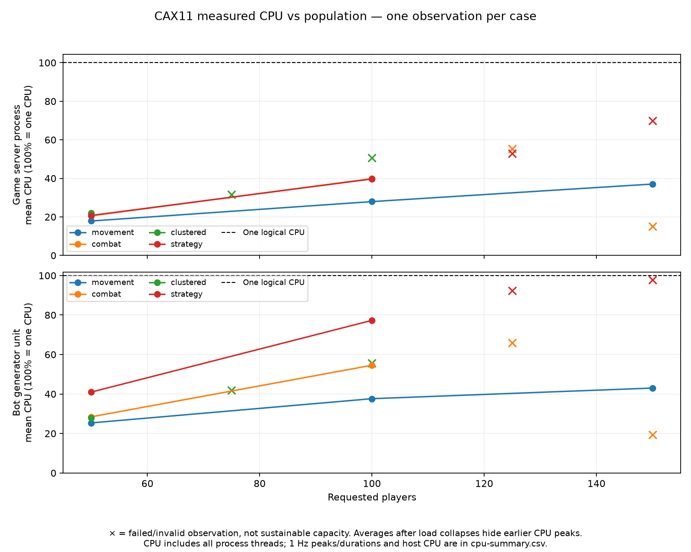

# [PENDING title] Part 2: Load-testing Omega, a bit-packed Rust game server

> **First draft, Article C2 (part 2 of the two-part split, ~4k words of body).** Written for
> [Write the full first draft of the article](https://github.com/Operatorr/godot-networking-poc/issues/33).
> Part 1 is [`omega-load-testing.C1.md`](omega-load-testing.C1.md); the single-article version is
> [`omega-load-testing.A.md`](omega-load-testing.A.md). This part condenses Article A §0–§1 and
> §5–§9 and adds a short recap of Part 1's math so it stands alone. Appendices are shared:
> [`omega-load-testing.appendices.md`](omega-load-testing.appendices.md). Evidence rules and markers:
> [`README.md`](README.md).
>
> **Title candidates** (`[PENDING]`):
> 1. *We wanted 1000 players on one server. The first build broke near 190.*
> 2. *Load-testing a bit-packed Rust game server on a $7.59 box*
> 3. *Our load test found bugs before it found a ceiling*

---

## 0. Cold open: five ramps, one wall

We asked a small ARM server for 200 players. It reached 191 before new players started timing
out. We asked for 250 and it reached 185. Then 500 gave 176, 750 gave 180, and 999 gave 190.

Five requested sizes spread over a factor of five, and every ramp stopped in the same 15-player
band. The server was a Hetzner CAX11 (two shared Arm vCPUs, 4 GB RAM, Falkenstein), quoted at the
time at **$7.59 a month** including an IPv4 address. A second CAX11 in the same zone ran the bots.

Each time, the game host's kernel first started dropping UDP datagrams because the socket's
receive queue was full. That began at **131–164 players**, while the game process used only
**57–76% of one core**. Later the CPU climbed to a full core, players dropped, joins timed out,
and the controller aborted.

That band sits right next to what the industry ships: Warzone's 150, Star Citizen's ~100 per server
before meshing, Battlefield's 64 after trying 128. [Part 1](omega-load-testing.C1.md) explains why
that range exists. This part shows it happening in our own bytes.

One warning first: **191, 185, 176, 180 and 190 are the peak connected-player counts from those
five attempts, not sustainable player capacities.** Each test gradually added bots—a "join ramp"—
toward its requested population. All five failed before reaching the five-minute measurement
window, so they don't establish how many players the server could reliably sustain.

Eight days later, after a round of correctness fixes to the
server, the client and our own measurement code, a fixed build held **150 players for five clean
minutes**. Its 200-player attempt couldn't be measured, because the bot host was dropping packets
too. The fixed build's ceiling is **unknown**.


*F1. CPU and population per Strategy ramp, original build. Source: [Strategy extension report][strategy-ext].*

---

## 1. What Omega is

Omega Realm is a top-down 2D bullet-hell shooter built to stress-test netcode. Gameplay is minimal
on purpose: three Classes, a shooting attack and one ability each, HP only, one monster type. The
question behind it: can one server **Instance** hold **500–1000 concurrent realtime players**?

- **`omega-server`** is Rust, with a **single-threaded, fixed 30 Hz Tick**. One thread runs the
  simulation, services the network, encodes and flushes.
- Transport is **ENet over UDP** (`rusty_enet` 0.4.0). Three channels: ch0 unreliable sequenced
  (Snapshots), ch1 reliable (Baselines, Game events), ch2 unreliable sequenced (input).
- **`sim_core`**, a shared Rust crate, runs on the server and inside the Godot client's prediction,
  so they can't diverge. The rule: **the client requests, the server decides.**

Terms used exactly: a **Tick** is one server simulation step (33.3 ms); a **Snapshot** is one
world-state message to one client, here one per Tick; a **Baseline** is a full Snapshot later
deltas are encoded against; **AoI** is the region around a player whose entities that player is
sent; a **Game event** is a one-shot occurrence like a shot or a kill. A **Frame** is a client
render, never a Tick.

The load tests use one Arena Instance, 2,000 × 2,000 units, with the Go API and persistence switched
off. This part doesn't cover how the game *feels* (prediction, interpolation, render smoothness);
it is about how many players one Instance can carry, and why.

---

## 2. Recap: the formula in one page

Part 1 derives this in full. What this part needs:

```
down per client   D = f · ( ceil(k · b_e / 8) + d · (H_s + H_d) )
server egress     E = N · D
naive broadcast   k = N − 1                       → E grows as N²
AoI               k = min(N − 1, ρπR², k_max)      → E grows as N · k
```

Here f is the Snapshot rate, k the entities in one client's Snapshot, b_e the bits per entity,
H_s the Snapshot header, H_d the 38 bytes every IPv4 datagram costs below the game (20 IP + 8 UDP +
2 ENet header + 8 ENet command), and d the datagrams per Snapshot.

Two consequences. First, **bit-packing and delta encoding are constant factors**; only shrinking k
changes the exponent. Second, a Snapshot should fit one datagram: the IPv6 minimum MTU of 1,280
bytes, less 60 bytes of worst-case headers, leaves 1,220, so we cap game payload at **1,200 B**.
At 1000 players and 30 Hz, naive broadcast of 63-bit records needs about 2 Gbit/s of egress; with
k capped at 64 it needs 133 Mbit/s.

Part 1's two reference points sit at opposite ends of k. **Battlefield** keeps nearly everyone
relevant to everyone, k ≈ N − 1, and pays in tick rate: DICE's 2015 guidance put a 64-player
server at 60 Hz on a whole box, four times the hardware per match of the 30 Hz default. **Rust**
runs a hard grid cull of about 350 m on a 4.5 km map, so at 1000 players k is roughly 10–40, and
its per-player traffic works out to about 14.3 kB/s [D]. Rust gets past the bandwidth wall and hits
a CPU wall at a few hundred players instead. Keep both in mind for where Omega lands.

On the CPU side, the work per Tick has an N · k serialisation
term against a fixed 33.3 ms budget. Formula sheet: [Appendix A](omega-load-testing.appendices.md#appendix-a-formula-sheet).

---

## 3. Omega's wire format, bit by bit

Every packet is `[u8 type][payload]`, no length field (ENet keeps datagram boundaries). Bit fields
are packed **LSB-first**; byte-sized writes pad first, so headers stay byte-aligned and only entity
records form a bitstream. Positions are `trunc(v × 10)` clamped to i16: 0.1-unit steps, truncated
toward zero. The Arena is 2,000 units wide, so 15 bits would do; we send 16.

**Upstream** is a 22-byte `PlayerInput` every Tick: sequence, input flags, aim, predicted position
and velocity, cursor, render Tick and RTT, all byte-aligned. That's **660 B/s** of payload, or
1.8 KB/s on the wire, since each 22-byte input rides in a 60-byte datagram. It isn't bit-packed;
packed, it would be 13–14 B. Full layout: [Appendix B](omega-load-testing.appendices.md#appendix-b-full-bit-layouts).

**Downstream** is the Snapshot:

```
Delta Snapshot header (16 B)
┌──────┬──────────────┬──────────────┬───────┬────────────────┬──────────────┐
│ type │ server_tick  │ server_ms    │ flags │ baseline_tick  │ entity_count │
│ u8   │ u32          │ u32          │ u8    │ u32            │ u16          │
└──────┴──────────────┴──────────────┴───────┴────────────────┴──────────────┘
Moving player, position-only record = 49 bits
┌──────┬───────────┬──────┬──────────┬──────────┐
│ kind │ offset    │ mask │ qx       │ qy       │
│ 2 b  │ 10 b      │ 5 b  │ 16 b     │ 16 b     │
└──────┴───────────┴──────┴──────────┴──────────┘
```

> [FIGURE F3 — new] Bit-layout diagram: header, then one player (49 b), projectile (54 b) and
> monster (53 b) record, to scale.

The 2-bit kind plus an offset replaces a `u16 id + u8 type`. The 5-bit mask says which fields
follow (POSITION, ANIMATION, FLAGS, REMOVED, FULL). A moving player costs **49 bits** a Tick, a
projectile **54**, a monster **53**; a full Baseline player record is 63. "Delta" here means
omitting unchanged fields; every field sent is absolute. Every 100 Ticks the client gets a Baseline
on reliable ch1, and since the correctness fixes, dependent deltas wait for its exact
acknowledgement.

**AoI** is 1,000 units to enter and 1,100 to leave; the gap is hysteresis, so an entity on the edge
doesn't flicker in and out. Each delta Snapshot has a 1,200-byte budget, header and removal records
included, filled greedily by priority: importance (player 10, projectile 8, monster 4) plus Ticks
since the entity was last sent, minus a distance penalty, plus a bonus if it changed. Here is the catch: the Arena is only
2,000 × 2,000 units. In a measured 50-bot run a bot saw on average **about 42% of everything** in
the Instance. **In this Arena our AoI is a modest cull, not interest management.** k is a fixed
fraction of N, so we sit on the N² branch of the formula.

### Where the bytes go

> [AUTHOR] This tally ran locally on commit `62fbfc3`, before the correctness fixes, with default
> bots. Layouts didn't change, so bit costs stand; shares are indicative. Fixed-build shares: **[MEASURE]**.

| Per bot per second, downstream payload | B/s | Share |
|---|---:|---:|
| Delta Snapshots (avg 384 B) | 11,410 | 83.4% |
| · projectile records | 7,466 | **54.5%** |
| · player records | 3,399 | 24.8% |
| ActionConfirm (16 B per Tick) | 475 | 3.5% |
| Game events (132 per second) | 1,627 | 11.9% |
| · `PROJECTILE_FIRED`, every shot in the Instance | 1,125 | 8.2% |
| Total | **13,687** | |

> [FIGURE F4 — new] Stacked bar of this table.

Check: 16 B + (16.7 player records × 54.7 b + 37.1 projectile records × 54.2 b + 0.27 monster
records × 53 b) / 8 ≈ **383 B**, against 384.1 B measured.

1. **Projectiles are re-sent every Tick, though their flight is deterministic.** A projectile moves
   400 u/s, 13.3 u per Tick, far above the 0.05 u change threshold, so each visible projectile costs
   a 54-bit position every Tick: **202.5 B/s per viewer**. The `PROJECTILE_FIRED` event already
   carries its origin, direction and fire Tick. So we pay twice, once for the reliable event and
   again every Tick of the bullet's life (1.4–2.0 s nominal, about 0.9 s on average once hits and
   walls cut it short). That's the biggest waste in the protocol, and it's a design choice, not a bug.
2. **Game events go to every peer**, not AoI-filtered or budgeted. Every client pays for every shot
   fired anywhere in the Instance. That's an O(N) per-recipient term however small the AoI gets.
3. **About 1 KB/s per player is fixed** before anything else is drawn: the Snapshot header, the
   16-byte ActionConfirm, the player's own record and a 1 Hz metrics packet.

On the wire, ENet and IP add about 74 B per Tick per peer downstream: one datagram carrying 28 B of
IP/UDP, a 4 B ENet header, 8 B per unreliable command and 6 B per reliable event. That is about
**+16%** on top of the payload. Reliable events are the expensive kind: a 12-byte
`PROJECTILE_FIRED` carries a 6-byte command header, and the client owes an 8-byte ACK for it.

**D8, the cost model [D].** Fitting coefficients to that run:

```
R(N) ≈ 1.3 KB/s + 0.42·(N−1)·157 + 0.42·N·1.7·209 + 30·N  ≈  1.3 KB/s + ~245 B/s · N    per recipient
E(N) = N · R(N)   → quadratic
```

The 0.42 is the visible fraction, 157 B/s a visible player, 1.7 the projectile-seconds each player
keeps in the air, 209 B/s a visible projectile, and 30 B/s the broadcast-event cost each player adds
for every recipient. The Snapshot alone reaches the 1,200 B budget when
(1200 − 16) / ((0.42 × 157 + 0.42 × 1.7 × 209) / 30) ≈ **165 players**. Past that the scheduler
starts deferring records, while broadcast Game events keep growing without bound: about 15 KB/s
per recipient at 500 players and 30 KB/s at 1000.

> [AUTHOR] Fitted at N = 50 with default bots, then extrapolated. Keep the word "model".

---

## 4. How we load-tested it

- **Two CAX11 hosts**, one game, one bots, same zone. Pinned release ARM builds, unsigned dev
  tickets, no API or persistence, UDP restricted to the bot host.
- **The bots are real clients**: `omega-load-test` links the same `protocol` and `sim_core` crates,
  so each bot encodes real input and runs real prediction.
- **Workloads**: idle, movement, combat, clustered and **Strategy** (target selection, orbiting,
  intercept aim, dodging, sprint, dash, abilities).
- **Each cell**: 30 Hz input, 100 ms join stagger, 60 s warmup, a **300-second measured window**, one
  observation.
- **Gates**: 30 Ticks per second held; each bot's input ≥ 29.7 Hz offered *and* on the wire;
  population held; error counters clean; received AoI correct. A requested population is not an
  achieved load.

Collection was compact: per-second host counters, exact window counters and a 1/64 UDP fingerprint
sample for delivery estimates, but no payloads. One compact bundle was 1.12 MiB, against 110.5 MiB
for full packet capture.

### It found bugs before it found a ceiling

**Round 1**, the first campaign: the UDP adapter **ignored ENet's requested socket buffers** (effective
212,992 B, 524,288 B after the fix); a cache/Baseline mismatch let entities re-enter with partial
records; new entities couldn't recover from losing their first FULL record; host maintenance
silently restarted a capture.

**Round 2**, server or bots? The first Strategy 150 cell failed because the *bot host* sat at 97.8%
of a core and offered 18 inputs a second instead of 30. Fixing the bots' target search restored
29.993–30.000 Hz. A reproduced 200-player ramp matched all 172,927 receive errors to the game
socket's own drop counter, with zero interface, qdisc or checksum errors: these were **socket queue
drops**. The kernel had datagrams for the game and nowhere to put them, because the game wasn't
reading fast enough. Gaps between socket reads grew from about 26 ms to a maximum of 443 ms, and
reliable retry bytes grew from 132,337 to 13,688,810 across equal 9-second windows, about 100×.
A 4 MiB receive buffer let all 200 players join, then collapsed with 159,266 drops. A bigger queue
absorbs a burst. It doesn't add throughput.

**Round 3**, the correctness campaign. The author's rule was that no result could rest on a build
with known bugs, so we fixed them and reran ([PR #44][pr44]): delta budgets now count the header
(a "1,200 B" delta could reach 1,216 B); deltas wait for the exact Baseline ACK instead of the last
Baseline sent; old ch0 deltas can't recreate entities a newer Baseline removed; Baselines respect
the decoder cap; recovery uses AoI. Two fixes were in our measurement: the bot checked received AoI
against the observer position from a different moment, and the Tick-rate estimator divided a span
that included the spawn phase by a fixed duration (it once reported 32.9 Hz for a 30 Hz server).

That campaign took **23 attempts and 20 launched workloads to get 10 clean cells** out of 12 planned,
a 43.5% attempt yield. Our own assessment calls it a campaign-management failure: too much effort
went into repeated harness and storage failures without an early stopping budget.

> **Sidebar: a number that lied.** `[AUTHOR: keep or cut]`
> An early report said the server ran at **32.9 Hz**. It runs a fixed 30 Hz accumulator; the
> estimator divided a Tick span that included the spawn phase by a fixed 120 s run:
> 30 × 131.6 / 120 = 32.9. The fixed estimator pairs each Snapshot Tick span with its server-clock
> span, and on the clean Strategy 150 cell reports **29.99998120034632 Hz**, which *fails* the
> unchanged `>= 30` criterion because of the 1 ms clock resolution, while the Tick log shows exactly
> 9,000 Ticks in 300 s. We kept both and didn't round the failure into a pass. The original
> 32.9 Hz report is now recovered ([recovery record](../netcode/perf-notes/load-test-reports/2026-06-recovered/SUMMARY.md)); 131.6 s is an explanatory
> reconstruction, not a recovered timing trace. Raw Tick-span endpoints are absent.

---

## 5. Results

### Recovered June history — separate from the capacity results

The original reports have now been recovered from this computer. The remote runs used bots
on the author's computer against the then-current DigitalOcean server in Singapore; fourteen
other reports target localhost. The [recovery record](../netcode/perf-notes/load-test-reports/2026-06-recovered/SUMMARY.md) inventories all nineteen files,
preserves their hashes and reconciles the original summaries.

| Remote report (19 June) | Requested / connected bots | Server players | Recorded duration | Last reported Tick avg / max | RTT avg / p95 |
|---|---|---|---|---|---|
| 17:06:20 baseline | 50 / 50 | 51 | 120 s | 3.00 / 4.11 ms | 44.1 / 47 ms |
| 17:24:02 stress attempt | 200 / 99 | 100 | 300 s | 11.70 / 17.41 ms | 46.8 / 49 ms |

These are historical observations, not clean capacity results or a controlled comparison with
CAX11. The Tick numbers are the latest rolling server metrics, not full-run averages/maxima.
The stress report records 101 reason-2 disconnects; the old note attributes them to the
100-player admission cap. Its “50.5% crash rate” counted rejected/disconnected bots, not observed
server crashes. Neither report pins the binaries, configuration or generator utilization.
The recovered note's extrapolated player ceilings remain unsupported; we do not import them
into the capacity figures or use cumulative server counters as measured run egress.

The October campaign uses two builds, never mixed: the **original build** (game `b1266c1`, 14 Oct 2026, 512 KiB socket buffers)
and the **fixed build** (game SHA-256 `de92e120…`, 22–24 Oct 2026, 4 MiB buffers). The fixed build
that was load-tested is the campaign's binary; the fixes extracted to `master` were validated
locally, not load-tested again.

**Fixed build, clean cells**, one 300-second observation each, all at 30.0 Ticks per second
([accepted audit][audit]):

| Workload | 50, Tick-work p99 | 100 | 150 |
|---|---:|---:|---:|
| Idle | — | 8.02 ms | not clean |
| Movement | 5.56 ms | 9.54 ms | 13.61 ms |
| Combat | 6.74 ms | 14.61 ms | — |
| Clustered | 7.19 ms | — | — |
| Strategy | 6.88 ms | 14.15 ms | **26.25 ms** |

**Strategy 150**: all 150 authenticated for 300 seconds, 9,000 Ticks, p99 **26.25 ms** of 33.33,
ten Ticks over budget, every peer passing wire cadence (29.81–29.99 Hz), delivery and received AoI
across 203,603,817 matched positions, zero correctness or UDP errors. One cell, not a capacity
certificate. Not every player was fighting: the living population ranged from 102 to 143, and the
median monster count was zero.

**[D] The tail grows faster than N, sometimes.** Strategy p99 grew × 2.06 from 50 to 100 players and
× 1.86 from 100 to 150. Fitting p99 ∝ N^a to each step gives a ≈ 1.04, then a ≈ 1.53; Movement gives
0.78, then 0.88. Single observations of a tail percentile are a hint, not a cost curve.

**The original ladder** for comparison: Movement passed 50/100/150; Combat passed 50/100 and
Combat 150 failed (a ~99% CPU episode for about 11 seconds, then 135 bots disconnected); Clustered
passed 50 and failed at 75 with kernel UDP errors; Strategy passed 50/100, while 125 and 150 failed
offered-load validation because of the generator, so they say nothing about the server. Original
Strategy 100 ran 30.000 Ticks per second, 29.981 Hz wire input, Tick-work p99 15.96 ms, game CPU
mean 39.7% of one core.

**D9, the N² in our bytes [D]**, original build:

| Strategy | Outbound IP B/s | Per player-second |
|---:|---:|---:|
| 50 | 1,093,347.36 | 21,866.95 |
| 100 | 3,670,419.81 | 36,704.20 |

Doubling N grew per-player bytes **× 1.68** and total egress **× 3.36**, against × 2 and × 4 for pure
N − 1 visibility; fixed per-player costs are the likely reason it's less [D, not isolated].

> [AUTHOR] Both rows are original-build, whose bytes include recovery traffic and the 16 B budget
> overshoot fixed later. Fixed-build outbound bytes per player-second: **[MEASURE]**. Don't
> substitute the fixed-build "39.66 KB/s" legacy figure; it sums both directions.

**Model against measurement [D].** The cost model predicts about 26 KB/s of payload per client at
N = 100, or about 30.2 KB/s with wire overhead, against 36.7 KB/s measured: 22% higher. Candidate
reasons, none isolated: the model was fitted to default bots, not Strategy bots that dodge, sprint
and use abilities; the original build sent extra FULL recovery records; outbound IP bytes include
reliable retries and Baselines. The order of magnitude holds; the gap is **unexplained**.

**Overload, original build**:

| Requested | Players at first receive errors | Game CPU then | Ramp peak |
|---:|---:|---:|---:|
| 200 | 131–139 | 56.8% | 191 |
| 250 | 157–164 | 69.0% | 185 |
| 500 | 156–162 | 76.2% | 176 |
| 750 | 132–140 | 58.1% | 180 |
| 999 | 150–157 | 64.1% | 190 |

CPU here is a one-second average, so a shorter stall or burst can overflow a queue while that
second still averages under 100%. The first interval with game CPU ≥ 95% came later, at 176–191
players.

> 
>
> *F5. CPU against requested population, original build.*

**Fixed-build Strategy 200** reached 200, fell to about 80 and aborted before measurement, with
135,913 game-host and 299 bot-host receive errors. With both hosts losing packets, it can't isolate
a server ceiling. And **Idle 150** didn't pass: every bot offered the right input rate, but 113 of
150 fell below the 29.7 Hz gate on the wire, while Strategy 150 passed. Cause **unknown**; both
follow-ups stopped at their local gates ([Idle150][issue45], [overload][issue46]).

**Yardstick [D, inference].** Riot's Valorant figures work out to 3,840 player-Ticks per core-second.
Original Strategy 100 ran 3,000 player-Ticks per second at 39.7% of a core, a naive 7,560 per
core-second; fixed Strategy 150 ran 4,500 per second on one serial loop. Same order of magnitude,
from a 2D sim with no animation or 3D traces. The comparison is loose: Riot's figure is a
provisioning target across a whole host, ours is one process's average or one thread's wall clock.

**Transfer [D].** At the original Strategy 100 rate, 3,670,419.81 B/s × 86,400 × 30 = **9.51 TB per
30 days**, 115.75 TB per year: arithmetic on a same-zone observation, not an invoice. Fixed-build
external transfer, monthly and yearly cost, and a 1000-CCU forecast: **[MEASURE]**. Network
impairment profiles and Snapshot-rate/AoI comparisons: **[MEASURE]**, deferred to [Stage 4][issue47].

---

## 6. Which wall did we hit? `[PENDING]`

> [PENDING headline] Draft framing: **"the same wall, with a twist: the receive path fails before
> the CPU does."** Alternatives: "how far a 2D top-down game can push it", or "we found the wall,
> then found our test was part of it".

What the data supports today:

- **On the original build, failure began in the receive path.** Socket queue drops started at
  131–164 players while process CPU averaged 57–76% of a core. Near-core CPU, lost players and join
  timeouts followed.
- **The diagnosis matched the drops to the game socket**, and saw read gaps and reliable retries
  grow during the failure: amplification after overflow. It didn't prove what started it.
- **A bigger queue delayed the overflow without sustaining 200.** Absorbing a burst isn't throughput.
- **On the fixed build, 150 passed** with p99 at 79% of the Tick budget. Beyond that, the limit is
  unknown, because the one overload attempt couldn't be measured.

Hypotheses, none proven:

1. **The serial loop runs out of time.** One thread services ENet, runs the Tick, encodes and
   flushes. While it encodes, nobody reads the socket, so inbound bursts (30 × N inputs a second,
   plus ACKs for every reliable event, and reliable events grow with N) must fit in the kernel
   queue. Strategy 150's p99 of 26 ms leaves a 7 ms margin.
2. **Bursts between reads overflow the queue** before average CPU looks busy.
3. **Reliable retries amplify the backlog** once drops start. The ~100× growth in retry bytes fits
   this; whether retries cause or follow overload isn't established.
4. **The generator contributes**, as it did at Strategy 150 and 200.

A coincidence to note, **not claim**: the cost model puts the 1,200 B Snapshot budget at ~165 players,
inside the receive-error onset. No causal link has been shown, the model is an extrapolation, and
receive-side drops concern inbound traffic, not Snapshot size.

**What 1000 would take**, using the levers from Part 1:

1. **Make AoI shrink k.** Our AoI sees ~42% of the Instance; Rust's sees 1–2% of its map. Either
   the Arena grows with N, or the radius shrinks, and both change the game.
2. **Stop re-sending deterministic projectiles.** Send the fire event and the removal, and let the
   client fly the bullet. That's about 54% of downstream at 50 bots. Monster shots would need real
   origins in their fire events first.
3. **AoI-filter Game events.** They're the only term that grows without bound once Snapshots cap.
4. **Get the Tick off one core.** Encode each entity's record once per Tick and copy bits per
   recipient, serialise per recipient in parallel, or split the Instance (meshing, sharding).
5. **Read the socket off the Tick thread**, so a long Tick doesn't leave the receive queue
   unattended.

None of these is implemented; each would need its own measurement.

---

## 7. Conclusion

On a $7.59 box, our first build's join ramps broke near 190, right where the industry stops, and
the bytes show the N² Part 1 predicts: doubling players grew egress more than threefold. Fixing our
bugs, several of them in the test itself, got a clean 150. Past that the ceiling is **unknown**
`[PENDING: headline]`.

The lesson that travels best: before you trust a capacity number, prove that the generator offered
the load, that the wire carried it, and that your checker measured what it claims. Ours didn't, at
first.

## Appendices

Shared: [`omega-load-testing.appendices.md`](omega-load-testing.appendices.md) (A formula sheet,
B bit layouts, C reproduce, D sources).

[strategy-ext]: ../netcode/perf-notes/load-test-reports/2026-10-14-one-pass/STRATEGY-EXTENSION.md
[audit]: https://github.com/Operatorr/godot-networking-poc/issues/31#issuecomment-6382173465
[pr44]: https://github.com/Operatorr/godot-networking-poc/pull/44
[issue45]: https://github.com/Operatorr/godot-networking-poc/issues/45
[issue46]: https://github.com/Operatorr/godot-networking-poc/issues/46
[issue47]: https://github.com/Operatorr/godot-networking-poc/issues/47
[issue28]: https://github.com/Operatorr/godot-networking-poc/issues/28
