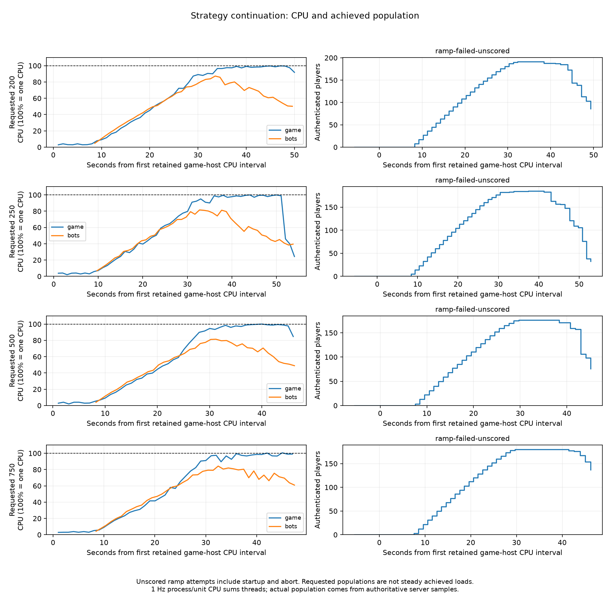

# Strategy overload continuation

The [lower-ladder checkpoint](PRE-STRATEGY-EXTENSION.md) was documented before these attempts. Each requested rung ran once in a separate subagent, sequentially on the same isolated hosts. The pinned binaries and original conditions were retained.

| Requested | Outcome | Ramp peak authenticated | Measured seconds | Game CPU peak | Bot CPU peak | Game / bot receive-buffer errors |
| ---: | --- | ---: | ---: | ---: | ---: | ---: |
| 200 | [ramp-failed-unscored](core-strategy-200-r1/agent-result.json) | 191 | unscored ramp | 99.74% | 87.28% | 198020 / 5095 |
| 250 | [ramp-failed-unscored](core-strategy-250-r1/agent-result.json) | 185 | unscored ramp | 99.93% | 81.51% | 197688 / 9719 |
| 500 | [ramp-failed-unscored](core-strategy-500-r1/agent-result.json) | 176 | unscored ramp | 99.99% | 81.40% | 176138 / 2901 |
| 750 | [ramp-failed-unscored](core-strategy-750-r1/agent-result.json) | 180 | unscored ramp | 100.54% | 84.26% | 196083 / 4032 |

CPU percentages use **100% = one logical CPU**. A two-vCPU host can reach 200% on this scale. Peaks are approximately one-second interval values, not instantaneous or tick-thread CPU. Near-95% duration is descriptive, not a pass gate. Failed-ramp CPU and kernel deltas cover differing startup/abort intervals and must not be compared as fixed-population steady measurements.

A requested population is not an achieved load. A ramp failure has no five-minute result or steady input-cadence conclusion. CPU near one core together with UDP errors and lost players identifies an overload episode; it does not locate an exact sustainable ceiling. Strategy 100 remains the highest passing native rung in the preserved campaign state; the earlier offered-load failures remain unchanged.

[Numeric comparison](strategy-extension-summary.csv) includes CPU coverage, means, p99, peaks and seconds ≥95%. [Dispatch ledger](strategy-extension-ledger.json) and each agent result retain outcome, errors, archive checksums and cleanup proof.

Across these attempts, the first retained game CPU interval ≥95% coincided with **176–191 authenticated players**, using the per-Tick population within that CPU interval. This locates observed startup overload episodes; it is not a validated steady-player ceiling.

