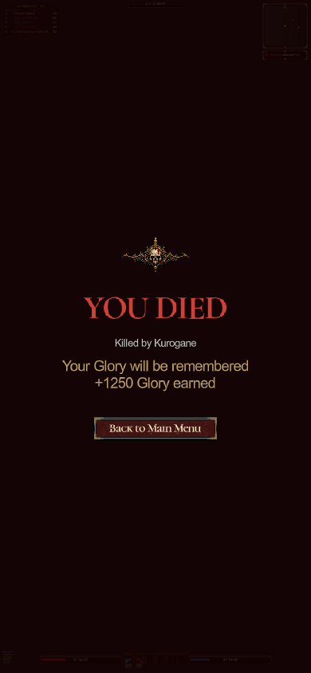
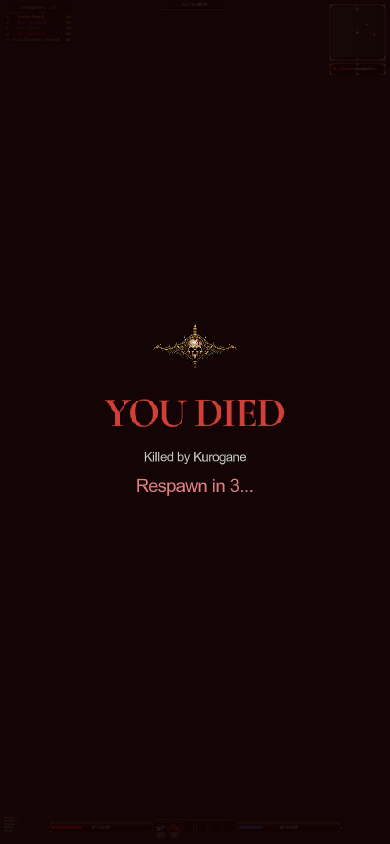
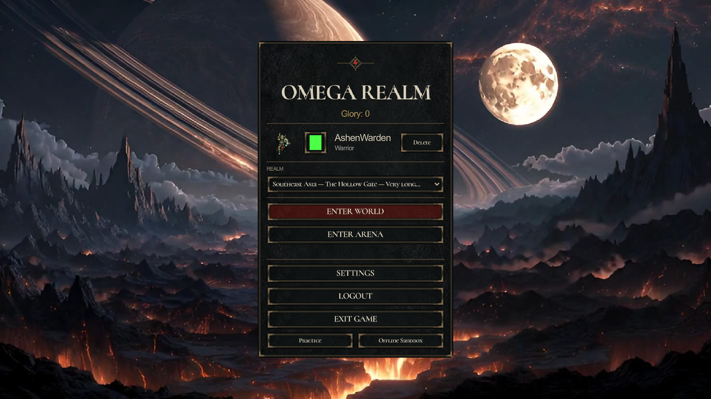

# Aged-bronze UI and frameless death screen

Before: `db05991` (silver hybrid UI). After: the revision committed alongside this gallery. All 34 pairs use real Godot captures and the same offline fixture.

The shared hardware now uses muted brown-bronze shadows and restrained warm highlights. Iron PNG surfaces, native typography, crimson actions and resource-fill colors remain. Softcore and Hardcore death content retains its skull artwork, text, button, layout and screen dimming, with no panel frame or textured background.

## Validation

- `ui_theme_regression.tscn`: material apertures, input/focus, dropdown spacing, narrow menus, frameless death content and transformed button clicks.
- `hud_bar_regression.tscn`: complete resource troughs, transparent frames and clamped values.
- `window_mode_regression.tscn` and `settings_save_regression.tscn`.
- Windowed capture fixture: 1280×720, 1920×1080 and 390×844. All PNG dimensions verified.
- Scene/reference checker: 499 files, 0 errors, 0 warnings. Editor import and `git diff --check` clean.

## Reproduce

```sh
python3 scripts/art/build_ui_theme.py
godot --headless --editor --path client --import --quit
godot --windowed --path client res://scenes/test/ui_review_capture.tscn -- --capture=/absolute/output/path
```

## Before / after

### Main menu — long region label

| Previous silver UI | Aged bronze / frameless death |
| --- | --- |
|  |  |

### Hardcore death

| Previous silver UI | Aged bronze / frameless death |
| --- | --- |
|  |  |

### Softcore death

| Previous silver UI | Aged bronze / frameless death |
| --- | --- |
|  |  |

### Login

| Previous silver UI | Aged bronze / frameless death |
| --- | --- |
|  |  |

### Character creation

| Previous silver UI | Aged bronze / frameless death |
| --- | --- |
|  |  |

### Pause menu

| Previous silver UI | Aged bronze / frameless death |
| --- | --- |
|  |  |

### Health, mana, energy and action slots — full

| Previous silver UI | Aged bronze / frameless death |
| --- | --- |
|  |  |

### Resource bars and action cooldowns — partial / empty

| Previous silver UI | Aged bronze / frameless death |
| --- | --- |
|  |  |

### Character creation — valid name and Hardcore selection

| Previous silver UI | Aged bronze / frameless death |
| --- | --- |
|  |  |

### Character creation — valid name and Hardcore, 390×844

| Previous silver UI | Aged bronze / frameless death |
| --- | --- |
|  |  |

### Character creation — 390×844

| Previous silver UI | Aged bronze / frameless death |
| --- | --- |
|  |  |

### Confirmation dialog

| Previous silver UI | Aged bronze / frameless death |
| --- | --- |
|  |  |

### Connection lost

| Previous silver UI | Aged bronze / frameless death |
| --- | --- |
|  |  |

### Hardcore death — narrow

| Previous silver UI | Aged bronze / frameless death |
| --- | --- |
|  |  |

### Softcore death — narrow

| Previous silver UI | Aged bronze / frameless death |
| --- | --- |
|  |  |

### Error / retry dialog

| Previous silver UI | Aged bronze / frameless death |
| --- | --- |
|  |  |

### Complete HUD — 1280×720

| Previous silver UI | Aged bronze / frameless death |
| --- | --- |
|  |  |

### HUD — 1920×1080

| Previous silver UI | Aged bronze / frameless death |
| --- | --- |
|  |  |

### HUD — 390×844

| Previous silver UI | Aged bronze / frameless death |
| --- | --- |
|  |  |

### empty resources

| Previous silver UI | Aged bronze / frameless death |
| --- | --- |
|  |  |

### Complete HUD — partial resources

| Previous silver UI | Aged bronze / frameless death |
| --- | --- |
|  |  |

### In-game key bindings

| Previous silver UI | Aged bronze / frameless death |
| --- | --- |
|  |  |

### Leaderboard

| Previous silver UI | Aged bronze / frameless death |
| --- | --- |
|  |  |

### Loading

| Previous silver UI | Aged bronze / frameless death |
| --- | --- |
|  |  |

### Login — 390×844

| Previous silver UI | Aged bronze / frameless death |
| --- | --- |
|  |  |

### Main menu — 1920×1080

| Previous silver UI | Aged bronze / frameless death |
| --- | --- |
|  |  |

### Main menu — 390×844

| Previous silver UI | Aged bronze / frameless death |
| --- | --- |
|  |  |

### Minimap and kill feed

| Previous silver UI | Aged bronze / frameless death |
| --- | --- |
|  |  |

### Settings — audio

| Previous silver UI | Aged bronze / frameless death |
| --- | --- |
|  |  |

### Settings — controls

| Previous silver UI | Aged bronze / frameless death |
| --- | --- |
|  |  |

### Settings — 390×844

| Previous silver UI | Aged bronze / frameless death |
| --- | --- |
|  |  |

### In-game settings

| Previous silver UI | Aged bronze / frameless death |
| --- | --- |
|  |  |

### Settings — video

| Previous silver UI | Aged bronze / frameless death |
| --- | --- |
|  |  |

### World map

| Previous silver UI | Aged bronze / frameless death |
| --- | --- |
|  |  |
