# Grimdark UI review captures

[Latest aged-bronze revision](BRONZE.md) compares the current palette and frameless death screen against `db05991`, with 34 matched pairs. [Historical hybrid material revision](HYBRID.md) preserves the earlier silver/blood-panel comparison. The original-baseline gallery below also points to the latest captures.

31 before/after pairs captured from real Godot 4.7.2 scenes. Before uses commit `bb583d4`; after uses the implementation committed alongside this gallery. Both use the same offline fixture, names, resource values and window sizes. No account credentials or live server data are used.

The first four pairs are unscaled crops of the 1280×720 captures. All other images are complete viewport captures; click an image for its original resolution. The neutral terrain and fixed monster/NPC/landmark markers are a fixture for checking minimap clipping and marker styles, not replacement world art. HUD, world-map, death and connection screens share that fixture.

## Reproduce

```sh
godot --windowed --path client res://scenes/test/ui_review_capture.tscn -- --capture=/absolute/output/path
```

For the before version, extract `git archive bb583d4 client` into a temporary directory, copy the current capture script and its scene into the extracted client, provide the built `client/bin` GDExtension, and run an editor import before capturing. The fixture is compatible with both versions. For a baseline older than the launch override, also copy the current `client/autoload/game_manager.gd` into the temporary extraction so it honors `--windowed` before loading settings; this changes no captured UI. It redirects region reads to localhost and does not save preferences. Use `--auth-only` to capture only login and character creation, including narrow layouts and valid-name/Hardcore states. Captures require a graphical display. Native window and rendered texture dimensions are checked before saving.

Crops from `hud-1280.png`: bars `(120,610)-(1160,720)`; minimap/kill feed `(1040,0)-(1280,300)`; leaderboard `(0,0)-(280,200)`. The partial bars use the same crop from `hud-partial-1280.png`.

The shared theme also reaches login, character creation, dialogs, loading and connection/death screens; these are included even where layout was unchanged. Inventory/equipment/tooltip scenes are empty, unused scaffolds, not playable menus. Narrow HUD captures document the existing world stretch policy; this change does not introduce touch controls.

## Gallery

### Health, mana, energy and action slots — full

| Before | After |
| --- | --- |
|  |  |

### Resource bars and action cooldowns — partial / empty

| Before | After |
| --- | --- |
|  |  |

### Minimap and kill feed

| Before | After |
| --- | --- |
|  |  |

### Leaderboard

| Before | After |
| --- | --- |
|  |  |

### Complete HUD — 1280×720

| Before | After |
| --- | --- |
|  |  |

### Complete HUD — partial resources

| Before | After |
| --- | --- |
|  |  |

### Pause menu

| Before | After |
| --- | --- |
|  |  |

### In-game settings

| Before | After |
| --- | --- |
|  |  |

### In-game key bindings

| Before | After |
| --- | --- |
|  |  |

### Main menu — long region label

| Before | After |
| --- | --- |
|  |  |

### Main menu — 390×844

| Before | After |
| --- | --- |
|  |  |

### Settings — audio

| Before | After |
| --- | --- |
|  |  |

### Settings — video

| Before | After |
| --- | --- |
|  |  |

### Settings — controls

| Before | After |
| --- | --- |
|  |  |

### Settings — 390×844

| Before | After |
| --- | --- |
|  |  |

### Login

| Before | After |
| --- | --- |
|  |  |

### Character creation

| Before | After |
| --- | --- |
|  |  |

### Softcore death

| Before | After |
| --- | --- |
|  |  |

### Hardcore death

| Before | After |
| --- | --- |
|  |  |

### Confirmation dialog

| Before | After |
| --- | --- |
|  |  |

### Error / retry dialog

| Before | After |
| --- | --- |
|  |  |

### Connection lost

| Before | After |
| --- | --- |
|  |  |

### Loading

| Before | After |
| --- | --- |
|  |  |

### World map

| Before | After |
| --- | --- |
|  |  |

### HUD — 1920×1080

| Before | After |
| --- | --- |
|  |  |

### HUD — 390×844

| Before | After |
| --- | --- |
|  |  |

### Login — 390×844

| Before | After |
| --- | --- |
| 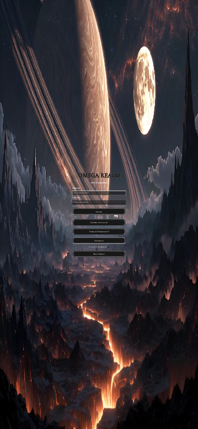 | 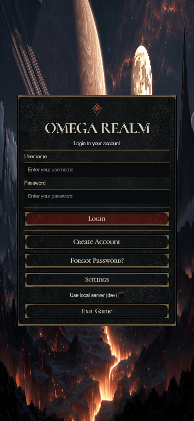 |

### Character creation — 390×844

| Before | After |
| --- | --- |
| 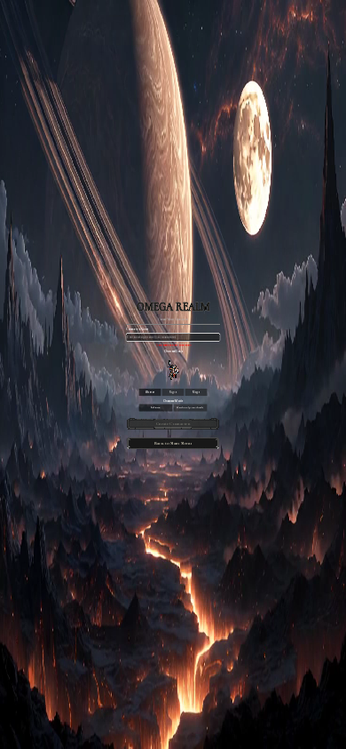 | 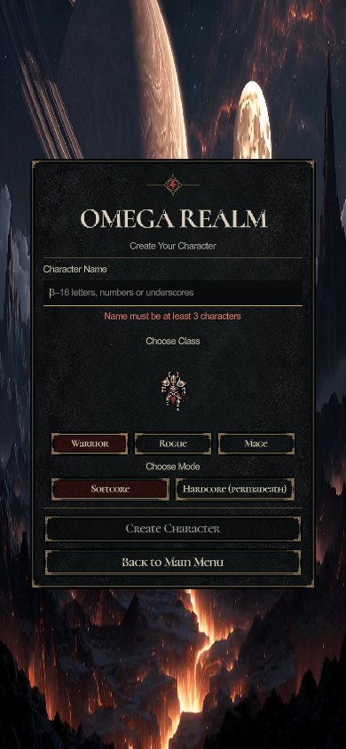 |

### Character creation — valid name and Hardcore selection

| Before | After |
| --- | --- |
| 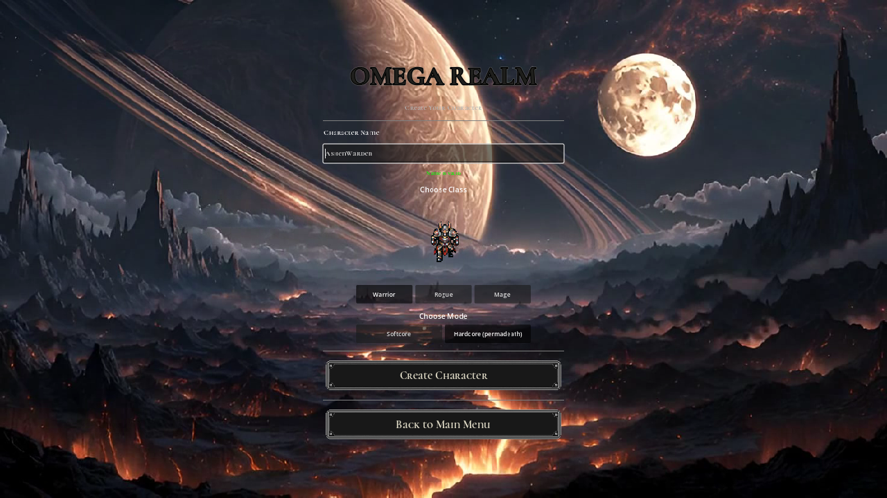 |  |

### Character creation — valid name and Hardcore, 390×844

| Before | After |
| --- | --- |
| 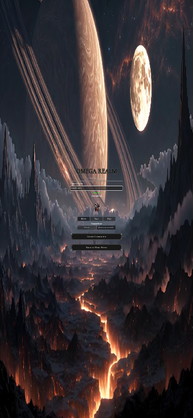 |  |

### HUD — empty resource bars

| Before | After |
| --- | --- |
| 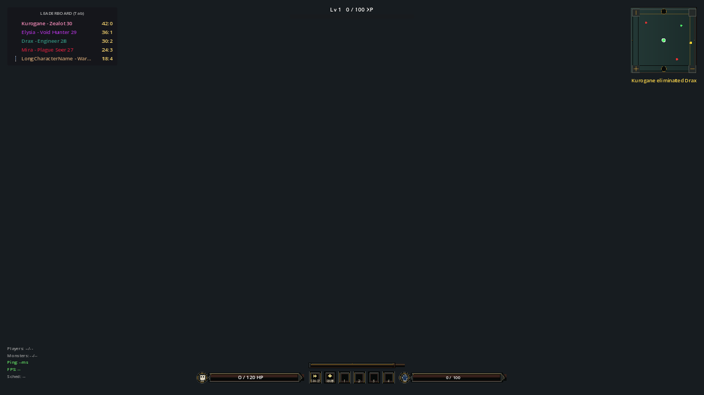 | 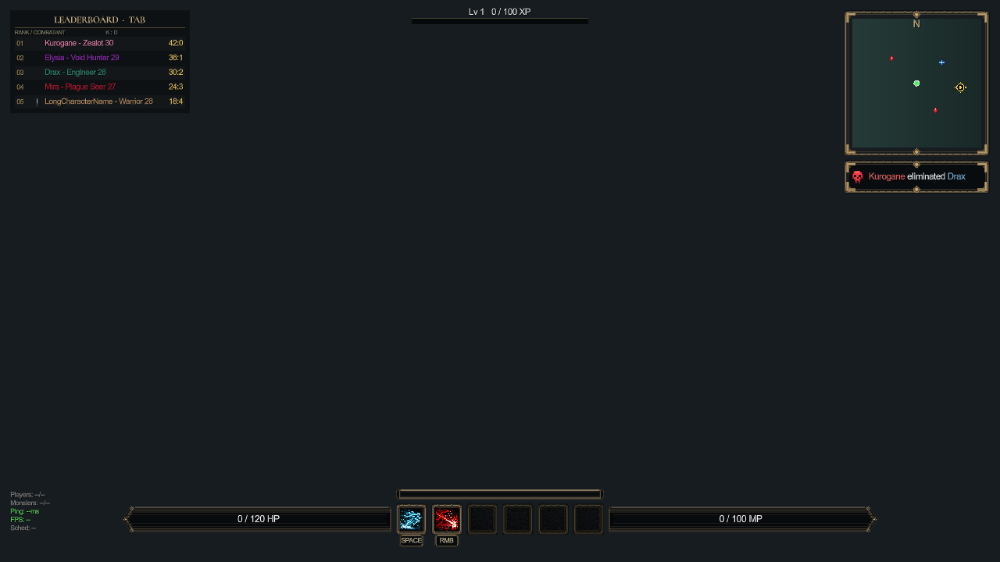 |

## HUD reference refinement

These four comparisons use the previous PR revision `9c6cba4` as the before image. They isolate the requested removal of the leaderboard frame, illustrated action slots and key badges, mirrored resource rails, and matching minimap/kill notification styling. Both revisions use the same windowed capture fixture. Unassigned action slots stay empty.

### Resource rails and action slots

| Previous PR version | Updated |
| --- | --- |
|  |  |

### Partial resources and cooldowns

| Previous PR version | Updated |
| --- | --- |
|  |  |

### Minimap and kill notifications

| Previous PR version | Updated |
| --- | --- |
| 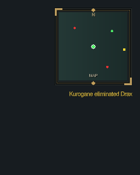 |  |

### Leaderboard without outer frame

| Previous PR version | Updated |
| --- | --- |
| 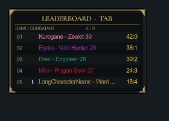 |  |

## Resource-bar spacing and alignment

Before is PR revision `9933dba`. Both resource bars move up 4 logical pixels to share the action-slot centerline. HP/action, action/mana and energy/action gaps now use the same 8-pixel layout spacing as the slots themselves. Geometry checks cover 1280×720, 1920×1080 and 390×844 layouts.

| Before | After |
| --- | --- |
| 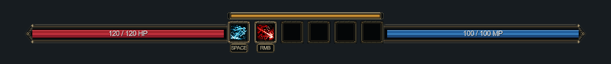 |  |
| 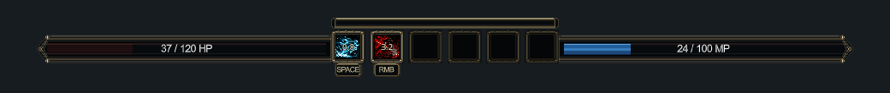 |  |
